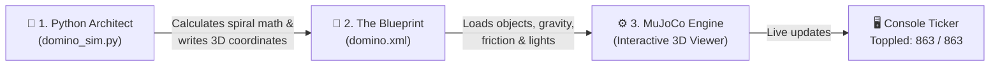

# 🁢 3D Domino Spiral Simulation — The Beginner's Guide

<p align="center">
  
  
  
  
</p>

<p align="center">
  <b>Watch 863 dominoes topple in a hypnotic 10-turn spiral powered by real-world physics!</b><br>
  <i>One tiny 30° nudge at the center ➔ pure gravity takes over ➔ a mesmerizing domino shockwave races to the outer edge.</i>
</p>

```
       [Start: 30° tilt]
              \
               ▼
             🁢 🁢 🁢 🁢
           🁢           🁢
          🁢   (Center)  🁢      🌊 863 dominoes toppling in sequence!
           🁢           🁢
             🁢 🁢 🁢 🁢 🁢 🁢 🁢 ──► Outward spiral wave!
```

---

## 📑 Table of Contents

- [⚡ Quick Start (Run It in 30 Seconds!)](#-quick-start-run-it-in-30-seconds)
- [🎮 Interactive Viewer Controls](#-interactive-viewer-controls)
- [🧩 The Big Picture (How It Fits Together)](#-the-big-picture-how-it-fits-together)
- [🔬 The 5 Secrets Behind the Magic (ELI5)](#-the-5-secrets-behind-the-magic-eli5)
- [🎛️ The Control Dashboard (Settings Cheat Sheet)](#️-the-control-dashboard-settings-cheat-sheet)
- [🧪 The Mad Scientist Cookbook (6 Fun Recipes to Try)](#-the-mad-scientist-cookbook-6-fun-recipes-to-try)
- [🧠 Code Tour (Friendly Step-by-Step)](#-code-tour-friendly-step-by-step)
- [📊 Reading Your Terminal Output](#-reading-your-terminal-output)
- [🩺 Troubleshooting & Common Fixes](#-troubleshooting--common-fixes)
- [❓ Frequently Asked Questions (FAQ)](#-frequently-asked-questions-faq)

---

## ⚡ Quick Start (Run It in 30 Seconds!)

You don't need a math degree or a high-end gaming PC to run this. If you have Python installed, you're ready!

### Step 1: Open your terminal
Navigate into the project folder:

```bash
cd Domino
```

### Step 2: Install the 2 required packages
If you haven't already installed them:

```bash
pip install mujoco numpy
```

> [!TIP]
> MuJoCo 3.0+ comes with full 3D interactive viewer support out-of-the-box on Windows, macOS, and Linux — no extra graphics libraries or complex compiler setup required!

### Step 3: Launch the simulation!

```bash
python domino_sim.py
```

### What you will see:
1. 🪟 **A 3D simulation window pops up.** You'll see 863 blue dominoes standing upright in a clean 10-turn spiral.
2. ⏳ **3-Second Preview:** Everything is paused for 3 seconds so you can adjust your camera and admire the setup.
3. 👆 **The Nudge:** The innermost domino tilts forward by 30°.
4. 🌊 **The Cascade:** A kinetic shockwave races smoothly around each ring, knocking down all 863 dominoes in about 38 seconds!
5. 🏁 **Victory:** The console celebrates: `SUCCESS: 100% of the dominoes toppled.`

---

## 🎮 Interactive Viewer Controls

The MuJoCo 3D window is fully interactive! You can fly around the spiral while the dominoes fall:

| Action | How to do it | What it does |
|---|---|---|
| **Rotate Camera** | `Left-click + Drag` | Spin around the arena in 3D |
| **Pan Camera** | `Right-click + Drag` | Move camera left, right, up, down |
| **Zoom In / Out** | `Scroll wheel` *(or Double-Right-Click + Drag)* | Get up close to individual domino collisions |
| **Pause / Resume** | `Spacebar` | Freeze time mid-fall to inspect the angle! |
| **Reset View** | `Double Left-Click` on an object | Centers camera focus on that domino |
| **Toggle Menu** | `Tab` | Opens/closes MuJoCo's built-in physics debug overlay |

---

## 🧩 The Big Picture (How It Fits Together)

Ever wondered how a physics simulation actually works? It's like a 3-act movie:



1. **The Architect (`domino_sim.py`)**:
   Runs high-speed geometry calculations to decide where all 863 dominoes should stand and how they should rotate so they face each other.
2. **The Blueprint (`domino.xml`)**:
   An MJCF (MuJoCo XML) file created on-the-fly. It defines the floor, lights, domino sizes, masses, and friction.
3. **The Physics Engine (MuJoCo)**:
   Takes the blueprint and calculates real Newtonian physics: gravity ($9.81 \text{ m/s}^2$), friction, impact forces, and angular momentum at 500 calculations per second!

> [!NOTE]
> `domino.xml` is automatically regenerated every time you run `domino_sim.py`. You never have to hand-edit XML tags!

---

## 🔬 The 5 Secrets Behind the Magic (ELI5)

Why does this chain reaction look so smooth and never break? Here are the 5 physics secrets:

### 🌀 Secret 1: The Spiral vs. The Concentric Trap

If you arranged dominoes in **separate concentric rings** (like a dartboard), the chain would topple ring 1 and then... stop. There would be no path to jump to ring 2!

Instead, this project uses an **Archimedean Spiral**:

```
      Concentric Rings (Fails ❌)           Archimedean Spiral (Works! ✅)
             ◎ ◎ ◎                                    ๑
     (Trapped in closed circles)              (One continuous road!)
```

Because it's a single spiral line from the center to the outside, **every single domino is on the exact same continuous track**. One push at the center reaches the very end!

---

### 📏 Secret 2: The Equal-Gap Magic (Arc-Length Spacing)

If you place dominoes by increasing the angle by a fixed amount (e.g., "every 5 degrees"):
- Near the center: Dominoes are jammed together like sardines.
- Near the outside: Dominoes are spaced miles apart and miss each other!

**The Fix:**
The code uses **arc-length pacing**. Just like walking with equal-sized footsteps, the code walks along the curve and places a domino **every 6 cm (0.06 m)** regardless of which ring it is on.

```
Center Ring:  [ 🁢 ] ── 6 cm ── [ 🁢 ] ── 6 cm ── [ 🁢 ]
Middle Ring:  [ 🁢 ] ── 6 cm ── [ 🁢 ] ── 6 cm ── [ 🁢 ]
Outer Ring:   [ 🁢 ] ── 6 cm ── [ 🁢 ] ── 6 cm ── [ 🁢 ]
```

Every domino has the exact same friendly spacing!

---

### 🧭 Secret 3: Each Domino Faces Its Next Neighbor

If a domino falls sideways, it might miss the next one completely.
The script calculates the **tangent angle (yaw)** of the spiral at every single spot:

```
        Top View:
        [🁢]  ─── Direction of fall ───►  [🁢]
         ▲                                 ▲
     Wide face                         Wide face
      (6 cm)                            (6 cm)
```

- **Face-to-Face:** The wide face (6 cm across) hits the next wide face.
- **Maximum Impact:** High surface contact guarantees reliable kinetic energy transfer!

---

### 🎯 Secret 4: The Push-Free Nudge (Pure Gravity)

Many beginner simulations cheat by firing an invisible cannonball or applying a massive artificial force to domino #1.

This simulation doesn't cheat:
- At time $t = 3\text{s}$, the script simply rotates Domino #1 forward by **30 degrees** using a rotation quaternion.
- Its initial velocity is set to **zero**.
- **Gravity does 100% of the work!** The center of mass is past its tipping point, so it falls naturally and smacks Domino #2.

---

### 📐 Secret 5: The "Tilt-o-Meter" (How It Counts Fallen Dominoes)

How does the computer know when a domino is "knocked down"?
Every domino has an internal vertical axis vector:

```
   Standing Tall            Tilted 60°                Flat on Floor
   Uprightness = 1.0     Uprightness = 0.5          Uprightness = 0.0
        ┌──┐                   \
        │🁢 │                    \ 🁢                 ══════ 🁢 ══════
        └──┘                      \
     [ Upright ]             [ Tipping Point ]           [ Toppled! ]
```

When a domino's uprightness drops below **0.5** (tilted more than 60°), the computer counts it as fallen!

---

## 🎛️ The Control Dashboard (Settings Cheat Sheet)

All the dials and knobs live right at the top of [`domino_sim.py`](file:///c:/Users/laasy/OneDrive/Desktop/mujoco_simulations/Domino/domino_sim.py#L10-L34).

Here is your quick-reference guide to tweaking them:

```python
# ============================================================
# CONFIGURATION
# ============================================================
TURNS = 10                  # How many rings in the spiral
INNER_RADIUS = 0.40         # Starting radius from center (meters)
SPIRAL_PITCH = 0.085        # Distance between adjacent spiral rings
TARGET_ARC_SPACING = 0.060  # ⭐ Distance between dominoes (meters)

HALF_X = 0.01               # Thickness / 2  -->  2 cm thick
HALF_Y = 0.03               # Width / 2      -->  6 cm wide
HALF_Z = 0.06               # Height / 2     --> 12 cm tall

TIMESTEP = 0.002            # Physics time resolution (seconds)
START_DELAY = 3.0           # Seconds to pause before first nudge
MAX_SIM_TIME = 400.0        # Max simulation time limit
STEPS_PER_FRAME = 20        # Speed multiplier (higher = faster)
INITIAL_TILT = math.radians(30.0) # Angle of the initial push
```

### 📏 The Golden Rule of Domino Spacing

> [!IMPORTANT]
> **Why do dominoes topple?**
> A domino that is **12 cm tall** (`2 × HALF_Z`) falls in an arc. If the next domino is **6 cm away** (`TARGET_ARC_SPACING`), the top half of the falling domino hits the middle of the next one with great mechanical leverage.
> 
> - **Too Far (> 10 cm):** Falling domino misses or barely grazes the next one.
> - **Too Close (< 2 cm):** Dominoes spawn overlapping and physically explode!
> - **Sweet Spot:** `0.045 m` to `0.065 m`.

---

## 🧪 The Mad Scientist Cookbook (6 Fun Recipes to Try)

Want to see something cool? Change just 1 or 2 lines in `domino_sim.py` and run it again!

---

### 🌊 Recipe 1: The Domino Tsunami (Dense & Fast)
Pack 30% more dominoes into the same spiral for an ultra-dense, satisfying ripple:

```python
TARGET_ARC_SPACING = 0.045   # (Default was 0.060)
```
* **Result:** Total domino count jumps from **863 ➔ ~1,150 dominoes!** The chain reaction sounds and looks like a rapid waterfall.

---

### 🌀 Recipe 2: The Mega-Spiral (1,300+ Dominoes!)
Turn your spiral into a giant labyrinth:

```python
TURNS = 14                   # (Default was 10)
SPIRAL_PITCH = 0.085
```
* **Result:** A gigantic 14-turn spiral that takes over a minute of simulated time to complete!
*(Note: If dominoes fall off the edge of the floor, increase `size="8 8 0.1"` on line 108 of `domino_sim.py`)*.

---

### 🎬 Recipe 3: The Matrix Slow-Motion
Want to watch dominoes collide in glorious cinematic slow-motion?

```python
STEPS_PER_FRAME = 5          # (Default was 20)
```
* **Result:** Everything slows down by 4x! You can pause, zoom in, and watch individual corners bounce and transfer momentum.

---

### 🎨 Recipe 4: Neon Cyberpunk Colors
Tired of standard blue dominoes? Open `domino_sim.py` and find line 129:

```python
# Change rgba="0.2 0.5 0.9 1" to your favorite color:
rgba="0.95 0.1 0.2 1"        # 🔴 Crimson Red
rgba="0.1 0.9 0.4 1"         # 🟢 Neon Emerald
rgba="0.95 0.6 0.1 1"        # 🟠 Sunburst Orange
rgba="0.8 0.2 0.9 1"         # 🟣 Cyber Purple
```

---

### 💥 Recipe 5: The "Failure Lab" (Watch Physics Break!)
What happens if the dominoes are spaced just slightly too far apart?

```python
TARGET_ARC_SPACING = 0.095   # (Default was 0.060)
```
* **Result:** The dominoes topple fine through turn 1, but around turn 3 the curve causes them to just miss! Watch the console report: `Chain did not complete.` This is a fantastic demonstration of physical tolerances!

---

### ⚡ Recipe 6: Zero-Delay Instant Launch
Don't want to wait 3 seconds at startup?

```python
START_DELAY = 0.0            # (Default was 3.0)
```
* **Result:** The first domino drops the exact millisecond the window opens!

---

## 🧠 Code Tour (Friendly Step-by-Step)

Curious about how the Python code is structured? Here's the 1-minute breakdown of each function in [`domino_sim.py`](file:///c:/Users/laasy/OneDrive/Desktop/mujoco_simulations/Domino/domino_sim.py):

### 1. `build_spiral_path()`
Calculates the $(x, y)$ coordinates and rotation angle (`yaw`) for every domino using the spiral equation. Returns a list of coordinates: `[(x0, y0, yaw0), (x1, y1, yaw1), ...]`.

### 2. `generate_xml(xml_path, path)`
Assembles the 3D world description text (`domino.xml`). It creates the sky, the lights, the checkered ground plane, and adds a `<body>` tag for each domino in the path.

### 3. `tilt_first_domino(model, data, joint_id)`
Rotates domino #0 by 30 degrees around its local Y-axis and zeros out its initial speed so it falls purely under gravity.

### 4. `get_uprightness(data, body_id)`
Reads the 3D rotation matrix of a domino and calculates its vertical alignment with the world Z axis. Returns `1.0` if upright, `0.0` if flat.

### 5. `count_toppled(data, body_ids)`
Loops through all dominoes and counts how many have `uprightness < 0.5`.

### 6. `main()`
The director that runs the show:
1. Generates the spiral ➔ 2. Writes XML ➔ 3. Boots MuJoCo ➔ 4. Opens the window ➔ 5. Triggers the tilt ➔ 6. Runs the simulation loop ➔ 7. Prints final score!

---

## 📊 Reading Your Terminal Output

While the simulation is running, your terminal prints live telemetry every 5 simulated seconds:

```text
=============================================
DOMINO SPIRAL SIMULATION
=============================================
Turns (rings): 10
Total dominoes: 863
Dominoes per turn (approx.): [83, 86, 89, 93, 96, 99, 103, 106, 109, 112]
Opening viewer...
Waiting 3 seconds...
Triggering first domino...
First domino tilted by 30.0 degrees.
Initial velocity is zero.
Simulation started.
  t =    5.0 s   toppled  118 / 863
  t =   10.0 s   toppled  254 / 863
  t =   15.0 s   toppled  397 / 863
  t =   20.0 s   toppled  530 / 863
  t =   25.0 s   toppled  664 / 863
  t =   30.0 s   toppled  795 / 863
  t =   35.0 s   toppled  850 / 863
All dominoes have toppled!

=============================================
SIMULATION RESULTS
=============================================
Simulated time: 38.2 s
Toppled:        863 / 863
Still upright:  0
SUCCESS: 100% of the dominoes toppled.
```

- **`t = 15.0 s`**: Simulated time (how many seconds have passed in the virtual universe, calculated in $0.002\text{s}$ time slices).
- **`toppled 397 / 863`**: Total dominoes that have successfully fallen.
- **`Dominoes per turn`**: Notice how each turn has more dominoes than the previous one! Because the spiral gets wider as it expands outward, the circumference grows, fitting more dominoes per ring.

---

## 🩺 Troubleshooting & Common Fixes

### ❌ `ModuleNotFoundError: No module named 'mujoco'`
**Fix:** Run:
```bash
pip install mujoco numpy
```
If you are using a virtual environment (`.venv`), ensure it is activated!

---

### ❌ `AttributeError: module 'mujoco' has no attribute 'viewer'`
**Fix:** You have an old version of MuJoCo (2.x). Upgrade to MuJoCo 3.x:
```bash
pip install --upgrade "mujoco>=3.0"
```

---

### ⚠️ Dominoes explode or bounce violently at $t = 0$
**Why:** The dominoes were spawned inside each other!
**Fix:** Ensure `TARGET_ARC_SPACING` is strictly greater than `2 × HALF_X`:
- `HALF_X = 0.01` means thickness is $2 \times 0.01 = 0.02\text{ m}$ (2 cm).
- Your spacing must be **greater than 0.02 m** (recommend at least `0.04 m`).

---

### ⚠️ The dominoes stop falling midway
**Why:** Kinetic energy dissipated or the gap is too wide.
**Fix:**
1. Decrease `TARGET_ARC_SPACING` slightly (e.g. from `0.060` to `0.055`).
2. Or increase `INITIAL_TILT = math.radians(40.0)` for a stronger start.

---

### 🖥️ Window is blank or rendering is sluggish
**Fix:**
- Reduce `TURNS = 5` to test with fewer objects.
- Increase `STEPS_PER_FRAME = 30` to lighten render overhead.
- Ensure your GPU graphics drivers are up to date.

---

## ❓ Frequently Asked Questions (FAQ)

<details>
<summary><b>Can I make the spiral rotate clockwise instead of counter-clockwise?</b></summary>
<br>
Yes! In <code>build_spiral_path()</code>, flip the sign of both <code>theta</code> and <code>y</code>:

```python
theta = -theta
y = -y
```
Flipping both preserves tangent alignment so dominoes still face the right way.
</details>

<details>
<summary><b>Why do dominoes use a "freejoint" instead of a hinge?</b></summary>
<br>
A hinge pins the base to the ground like a swinging gate. Real dominoes are unattached wooden blocks! A <code>freejoint</code> gives each domino full 6-degrees-of-freedom: it can slide, pivot, bounce, tumble, or slide across the floor.
</details>

<details>
<summary><b>Can I run this without opening a graphics window (Headless mode)?</b></summary>
<br>
Yes! Replace <code>mujoco.viewer.launch_passive(...)</code> with a simple <code>while</code> loop calling <code>mujoco.mj_step(model, data)</code>. This is great for running automated batch experiments or parameter tuning in the background!
</details>

<details>
<summary><b>Can I change the floor or background?</b></summary>
<br>
Yes! In <code>generate_xml()</code>, look for the <code>&lt;geom name="ground" ...&gt;</code> tag. You can change its color (<code>rgba="0.1 0.1 0.15 1"</code> for dark mode) or give it a grid texture.
</details>

---

## 🚀 Ready to Experiment?

Run the simulation right now:

```bash
cd Domino
python domino_sim.py
```

Sit back, relax, and watch the chain reaction unfold! 🁢🁢🁢
